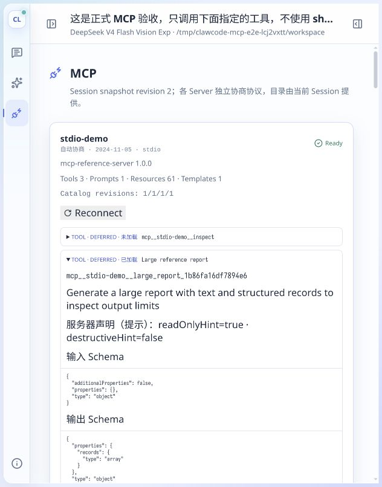
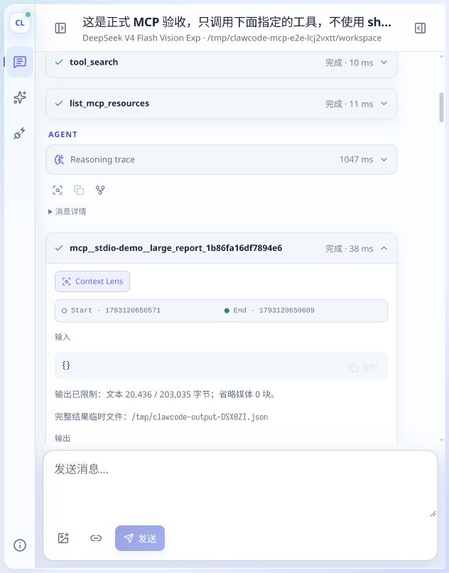

# MCP 工具发现、结果预算与协议协商：实现和验证记录

日期：2026-10-27。工作区基线为 `clawcode d14d189`，本地 Pi 为 `db14038bd`。
实现遵循原 spec；未使用 SubAgent、worktree，未 stage、commit 或 push。

## 实现结果

| 能力 | 实现落点与行为 |
|---|---|
| Pi 协商 | `mcp/client/{initialize,negotiation,request}.rs` 统一 initialize；支持 2025-11-25、2025-06-18、2025-03-26、2024-11-05。Auto/Preferred 都接受受支持的服务器选择，先验证再 initialized；HTTP 404 不触发透明重协商 |
| 名称与元数据 | `McpToolRef::public_name` 使用固定长度帧 SHA-256；有效原名保留，改写名不超过 64 ASCII 字节；服务器内部及会话合并目录都检查冲突。title、可选布尔注解、output schema、exposure 经借用 metadata 接口和 hook 传递 |
| 结果预算 | `tools/output.rs` 与 Provider 共用文本视图；hook 后、结束事件和持久化前结算。文本 20 KiB、媒体 4 块/8 MiB、完整文件 64 MiB、progress 1 KiB；文件错误独立于远端成功/失败状态 |
| 资源工具 | 一个 enum adapter 实现三个固定工具；快照分页默认 50、最多 200 条及 20 KiB，游标绑定上下文，URI 原样交给服务器，取消到达真实协议请求 |
| 选择与搜索 | `kernel/runtime/tools/{state,selection,search}.rs` 分离目录、loaded、disabled；有界 BM25 索引按目录复用。单次新增定义 32 KiB，加载只影响下一请求；同批调用使用原冻结 registry |
| 恢复与界面 | ActiveToolsChange 保存 version=1 的 selection 和兼容 activeTools；resume/fork/tree/空根/compaction/reconnect 恢复偏好。ACP 更新覆盖选择变化，WebUI 展示实际版本、元数据、加载状态与输出诊断 |

代码组织采用引用必要上下文的操作对象，如 `ToolRequest`、`ToolResultProjection`、`ResourcePage`、`ToolSelectionUpdate`、`ToolSearch`。转换使用 `From`、`TryFrom`、`FromIterator`、`Serialize`、`Write` 等 trait；新增大于三个字段的 struct 使用 typed-builder。

结果 hook 消费并返回同一个拥有的结果，避免复制尚未结算的大内容；搜索结果复用有界描述，不为显示摘要再次复制 schema。目录与选择没有引入新的持久化数据库。

## 首次实现的自动验证

| 命令/检查 | 结果 |
|---|---|
| `rtk cargo fmt --all -- --check` | 通过 |
| `rtk cargo check --offline --workspace --all-targets` | 通过 |
| `rtk cargo clippy --offline --workspace --all-targets -- -D warnings` | 通过，无警告 |
| `rtk cargo test --offline --workspace --all-targets`，临时 XDG_DATA_HOME、本机监听权限 | **714 通过，2 ignored，96 个 suite** |
| `rtk cargo test --offline -p mcp --test interop_stdio --test interop_http -- --ignored --nocapture` | **2 通过**；每个测试遍历四版本，即 8 个 transport/version 组合 |
| `rtk npm --prefix web run check` | 通过 |
| `rtk npm --prefix web run build` | 通过 |
| `rtk git diff --check` | 通过 |

最终全量日志：`/tmp/clawcode-mcp-final-tests.log`。测试使用隔离数据目录，未写入个人会话库。

重点覆盖：

- 握手中的不支持版本、未知版本、错误 ID、错误结果类型；实际 HTTP 版本头、404 不重初始化、活动与总时限、资源取消通知。
- 名称 golden、Unicode、64/65 边界、同服务器身份/名称冲突，以及 `a/_x` 与 `a_/x` 的跨服务器碰撞、旧目录保留和恢复。
- 聚合文本与 structured 投影、UTF-8、完整媒体保留、20 KiB 边界、64 MiB 文件上限、保存取消/I/O 错误、hook 放大结果、ACP 历史回放。
- 保存失败通过独立测试进程注入不存在的 TMPDIR；通用 AgentTool 调用计数保持 1，成功状态保持不变。真实 MCP 正常调用另由 JSONL 确认只执行一次。
- 并发加载合并、已加载不重复持久化、超大 schema 跳过、索引复用、目录撤下后的提交重验、同批未声明工具拒绝。
- 工具选择的 Store 同步失败不发布新选择，并阻止后续设置、消息、记录和导航写入；只读检查及关闭时刷新仍可用，重新打开后才允许写入。
- cursor 的 Session、kind、filter、revision 校验；limit 1/50/200、错误类型/null、超大单条、长服务器过滤条件、未列出模板 URI、Hidden 拦截。

一次 rustc/async-trait 宏展开发生 SIGSEGV；相同目标重试通过。未通过改产品逻辑绕过该编译器异常。最终静态检查及全量回归均通过。

## 正式 app 与真实 provider 验收

使用正式 `target/debug/clawcode` 和生产 `web/dist`，provider 为已配置的
`deepseek/deepseek-v4-flash-vision-exp`。MCP 参考服务器只作为外部协议服务，
未替换 app 或模型 provider。

- 独立环境：`/tmp/clawcode-mcp-e2e-lcj2vxtt`，凭据继续引用原环境变量，临时配置权限为 0600。
- app：`127.0.0.1:39080`；参考 HTTP：`127.0.0.1:39128`。
- stdio 实际协商为 **2024-11-05**；HTTP 实际协商为 **2025-06-18**，二者都由 Auto 发起。
- browser-skill 诊断为扩展未连接，使用应用内浏览器完成验收，没有修改浏览器设置。

持久化记录中的实际调用如下，而非依赖模型的自然语言自述：

| 模型轮次 | 实际结果 |
|---|---|
| 第一轮 | `tool_search("large.report")` 加载两个 Deferred 定义；资源第一页 50 条，模板列表 1 条 |
| 第二轮 | 调用 stdio 的 `large.report` **一次**；资源下一页 2 条；读取未列出的 `reference://topic/acceptance` 成功 |
| 第三轮 | `tool_search("hidden_probe")` 返回空加载集合及空 tools |

搜索和远端调用的 TurnId 分别为 `turn-E0P9oxyP_2aiSbBiIXqq5`、
`turn-3qCM5nJw0UBA9dWZS07XV`，确认下一请求生效。游标在加载工具后仍可继续使用。

大报告的共享文本投影从 **203,035 字节**缩减为 **20,436 字节**，低于 20 KiB。
完整规范化文件 `/tmp/clawcode-output-DSX0ZI.json` 为 **197,170 序列化字节**，权限 **0600**。
WebUI 正常结束和重载回放都显示相同诊断与路径。

进一步完成：

- 搜索后的 MCP 面板自动显示已加载，title、readOnlyHint=true、destructiveHint=false、output schema 正确展示。
- reconnect 后仍已加载；页面重载后结果正确回放。
- fork 继承目标分支选择，正式后端重启后 resume 仍保留加载状态。
- 真实 provider 生成 compaction 节点后仍保留选择。该项使用临时配置 `keep_recent_tokens=512`；原 20000 保留量在此短会话未生成压缩节点，用户默认配置未改。
- 导航到空根后两个 Deferred 报告都变为未加载；返回原 compaction 分支后恢复已加载。

原验收 Session：`session-b9sGnZkAZp7O7BdP6LRTI`；fork Session：
`session--XTPImBj7DhLE27p_eOe5`。结构化证据保存在 `/tmp/clawcode-mcp-e2e-evidence.json`。
真实 UI 验收之后补充的持久化失败保护，由故障注入、重新打开测试和最终全量回归验证。

## 清理、未验证范围与既有限制

- 临时浏览器页、app、HTTP 参考服务、stdio 子进程均已关闭；记录的三个进程均不存在，两个端口连接均被拒绝。没有停止其他进程。
- 验收配置、JSONL 和完整输出样本保留在临时目录；截图和本记录保存在项目中。
- **未实测真实第三方 MCP 的人工 OAuth/URL elicitation 授权流程，也未专门复测 WebUI 停止按钮。** 本地 OAuth、Host elicitation、请求取消和 shutdown 自动测试通过；这些结果不等同于外部人工授权验收。计划 9.6 为此保留未完成标记。
- 完整文件是临时文件，可能被系统清理；结果预算不限制 transport 缓冲峰值；资源分页来自完整快照；32 KiB 是单次新增定义预算，不是长会话累计声明硬上限。

原 spec 的 SHA-256 保持为
`b77e4c861c4899c5a8526db7193078b12a754f9020d427d88ee6b1ae4075fe4a`。

## 后续审查：六项问题修复

本节为最新修复状态。前述真实 provider/WebUI 验收是首次实现时的记录；本轮没有重复该端到端流程。

| 审查问题 | 修复 | 回归证据 |
|---|---|---|
| 高频 progress 饿死总超时 | 截止时间优先于回复和进度；取消前释放进度订阅与调用关联，统一发送有界取消通知 | `continuous_progress_cannot_starve_total_deadline`；原 20ms 复现从 829ms 仍未结束，变为约 22–23ms 返回 |
| 启动目录更新漏同步 | 订阅后立即同步目录；registry 构建与 published 基线使用同一捕获快照，后续更新也使用该快照 | `mcp_startup::startup_catalog_change_reaches_first_request`；原临时复现中的目录与首个模型请求均为 `mcp__dynamic__new` |
| 合法空结果中断下一轮 | Provider 转换为空成功结果补文本块；空失败结果保留明确错误说明 | `empty_mcp_result_reaches_provider` 覆盖成功、失败两种空结果 |
| 最后一页被二分错误排除 | 先测试最大候选页，再二分较短前缀；最终页去掉 cursor 后变小不再破坏搜索 | `complete_last_page_can_fit_when_its_prefix_does_not`，20,436 字节的完整两条记录正确返回 |
| 预算漏计 Provider 连接符 | 文本视图计入换行和空片段，媒体与尾注的边界一并预留 | `bounded_output_includes_provider_separators` 覆盖单字符及空文本片段；原实际 40,959 字节输出收敛至 20,436 字节 |
| 完整输出碎片写入过多 | `SpoolWriter` 使用标准库 `BufWriter`；统一执行序列化、限额检查和最终 flush，成功后才能保留文件 | `spool_coalesces_writes_and_flushes_complete_json`、`spool_reports_failure_from_final_flush`，以及原有超限、取消、保存错误测试 |

本机 debug 合成负载（100 万个整数）的完整投影由约 689ms 降至约 450ms。
这包含文本计量和落盘，不是生产吞吐保证；无缓冲/缓冲序列化的独立对比仍为约 200 万/842 次底层写调用。

最新验证：

- fmt、workspace check、严格 clippy、`git diff --check` 通过。
- 全量 **721 通过，2 ignored，97 suites**；ignored 的 stdio/HTTP 四版本互操作另行运行，**2 通过**。
- 上轮 `/tmp` 中五个独立逻辑复现全部转绿；复现日志：`/tmp/clawcode-mcp-review-fixes-probes.log`。
- 全量日志：`/tmp/clawcode-mcp-review-fixes-tests.log`。
- 没有新增依赖，未使用 SubAgent/worktree，未创建 commit。
