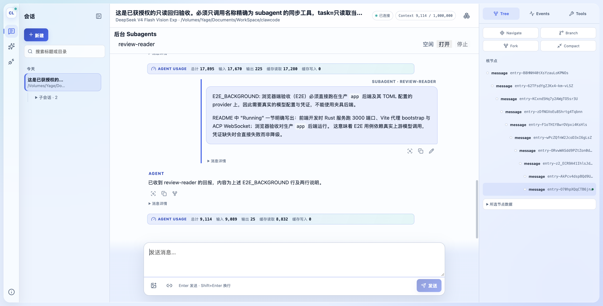

# Subagent 评审修复与 Pi 对照

## 2026-10-29 独立评审后续修复

本节是最新结果：**801 个测试通过、9 个忽略，104 个 suite**；Clippy、fmt、diff check、前端 check/build 通过。下文 795 项结果保留为前一轮记录。

- **WebUI 回放请求**：已知 child 不再刷新列表；未知 child 共用同一连接的在途查询，并在旧快照未包含它时重新查询。创建、删除、fork 和 run 结算后的列表刷新取得新快照，较旧响应不能覆盖新状态。
- **元数据查询**：新增 `SessionHeader { id, cwd, ownership, path }` 与共用的 header 扫描/定位。删除、后台名称查找、恢复所需的元数据不再读取 transcript 正文；普通 `session/list` 仍读取最新 title fact。
- **删除兼容性**：live 会话先取 cwd，closed 会话从 header 定位；子会话只按 header 的 ownership 扫描。存储删除同样只读 header，并保留对重命名、导入文件以及同 id 多份文件的处理。仍会遍历目录项或 header，不引入缓存和索引。
- **同名 spawn**：保留可控 Tokio 协作调度的回归测试，修复前创建两个同名 child，修复后只创建一个并返回 `already exists`。owner 级 async Mutex 覆盖查重和创建，等待锁后重新检查取消。创建阶段串行，子会话任务执行仍可并行。
- **错误日志**：保留底层 MCP 日志，在清理失败的调用点补充 owner、child 和设置应用失败阶段；不覆盖最初错误。
- **测试命名**：`review_regressions` 改为 `delegation`，测试去掉 `review_` 前缀；对应 retry sink 改为 `SubmissionSinks`。历史日志仍使用当时的旧名称。

### 真实回放对比

使用生产 app 和此前真实 provider 生成的会话 `session-B65e5ZKwzjVp0pvTbgcKy`，没有提交新的模型请求。相同 5 张历史工具卡片，后端 ACP trace 计数的 `session/list` 从 **5 次降至 1 次**；父会话的 13 个 crate 答案和 reader 回报均完整保留。浏览器前后两轮捕获没有错误。

证据位于 `.superpowers/sdd/2026-10-29-subagent-followup/`：`replay-request-counts.json`、`replay-before.txt`、`replay-after.txt`、`browser-before.json`、`browser-after.json` 及 `replay-app.log`。本轮没有新增截图或版本化计划文件。未重跑真实 provider 推理；存储删除、同名竞态与兼容性由集成测试覆盖。

AGENTS.md、RTK.md 的已有改动及之前的截图资产保持原样，未暂存或创建 commit。此处没有替用户决定未来提交的文件范围。

## 结论

评审的 6 项问题均已修复，同时完成提交结果语义统一和后台动作类型化。未创建 worktree、commit 或新增依赖；保留此前实现和用户已有改动。

工作区验证：**795 个测试通过、9 个忽略，104 个 suite**；Clippy `--workspace --tests --examples -- -Dwarnings`、fmt、diff check、前端 check/build 均通过。使用生产 app、已配置的 DeepSeek 官方 API 和 `DEEPSEEK_API_KEY` 完成前后台冒烟及冷重连检查，没有使用 fixture backend 验收 WebUI。

## 对照 Pi 的结论

参考仓库 `/Volumes/Yage/Documents/WorkSpace/pi`，当时 HEAD 为 `e65b3b88c`。只读检查，没有修改该仓库。

| 问题 | Pi 如何处理或规避 | clawcode 的落地方式 |
| --- | --- | --- |
| 排队输入拿到另一轮答案 | `packages/durable/src/harness/submissions.ts` 按 submission ID 注册等待者；`live.ts:endRun` 只结算当前 run 的 inputs。 | 队列发布前附加 `SubmissionReceipt`；实际消费时归入当前 run，结算通过一次性通道返回，不再读取全局最新结果。 |
| 重试等待中取消误报 Failed | `live.ts:endRun` 根据 run 的最终结束原因完成 submissions，不根据上一 generation/Turn 的失败推断取消。 | `RunSettlement` 是 `SubmissionAnswer` 的唯一生成点，直接和排队提交共用最终 `AgentOutcome`。 |
| 多个 child 并行恢复 owner 失败 | Pi 的 conversation 是持久记录上的句柄；`harness.ts` 的 conversation 查询和 `session.ts:readOnLine` 经过 Session 串行读写线，没有每个 child 独立重建同一 owner runtime 的结构。 | 复用现有 `pending_sessions` 构建预留，观察其完成信号；等待正在构建的 owner，再共享运行时。拒绝 ownership 环；对没有构建者的 Starting 状态返回错误，避免空转。 |
| 冷状态轮询全量读取 JSONL | `storage/sqlite/storage.ts:conversation` 按 ID 查询 metadata；`pi.live` 独立承载运行态。 | 增加兼容默认实现的 `StoreFactory::exists`；JSONL 实现按现有文件名定位候选，只解析 header。没有新增 SQL、缓存或持久索引。 |
| 前台答案超过工具预算 | `test/examples/21-subagent-foreground.ts` 直接返回子会话完整文本，没有对应限额。 | 使用 clawcode 既有 `ToolOutputPolicy::Bounded`，20 KiB 工具预算生效，完整答案仍保留在 child transcript。 |
| 单消息查询复制全部历史 | Pi 按 answer EntryId 查询 entry，SQLite 使用按 ID 的读取。 | 不新增另一套消息索引：结算时从本轮已有消息直接取得答案，删除 `stored_message` 及其全历史复制。 |

本期仍不移植 Pi 的持久 submission/task 调度器。回执及 Reporter 继续只在内存中，JSONL schema 与外部 `RunResult` 均保持不变。

## 代码组织

- 删除两套互相漂移的答案转换：不再由最后一个 `TurnOutcome` 推断 run 结果，也不再从会话最新状态补取答案。
- 排队回执在“消费、撤回、结算、异常退出”四个生命周期位置完成；新 run 无法覆盖前一轮的回执答案。
- `BackgroundAction` 通过 `TryFrom<&ToolCall>` 一次性校验，执行阶段使用 `match`，保留原有普通参数错误文案和后台取消边界。
- 冷恢复协调放在 ownership 模块；普通 create/delete 继续使用原来的独占预留语义。

## 失败到通过的证据

| 用例 | 修复前 | 修复后 |
| --- | --- | --- |
| `review_queued_submission_keeps_its_answer` | B 得到 `answer for C` | B 得到 `answer for B` |
| `review_submit_cancellation_during_backoff` | 已取消 run 返回 `Failed("service unavailable")` | `Cancelled`，与 RunEnd 一致 |
| `review_parallel_children_resume_shared_owner` | 第二个 child 返回 `SessionStarting` | 两个 child 都恢复成功 |
| `review_foreground_answer_respects_tool_budget` | 30720 字节全文进入父会话 | 使用现有 20480 字节工具预算 |
| `cold_runtime_status_does_not_parse_transcript_body` | 正文含非 UTF-8 字节时，状态查询因全文件读取失败 | 有效 header 足以返回 idle |
| `existence_lookup_*` | 缺少轻量查询 API | 验证正常/缺失/错误 header，不解析正文 |
| `background_actions_validate_before_execution` | 缺少类型化动作接口 | 参数错误与 followUp 分发测试通过 |

另补充：排队输入消费前与消费后的父取消，确认调用者等到 run 清理结束；ownership 环在等待构建预留前被拒绝。

存在性查询只确认会话身份，并不承诺 transcript 正文合法；实际恢复仍执行原来的正文校验。文件名定位仍遍历目录项，改进的是不再为每次轮询读取并解析全部历史正文。

日志目录：`.superpowers/sdd/2026-10-28-subagent-review-fixes/`，包括原始失败、针对性回归、完整 workspace tests、Clippy 和前端构建结果。

## 真实 WebUI 冒烟

生产后端使用原 `claw.toml`，官方地址 `https://api.deepseek.com`，密钥引用 `DEEPSEEK_API_KEY`，未读取或打印密钥。只覆盖测试数据目录为 `/private/tmp/clawcode-subagent-review-verification`。

- 父会话 `session-L08B9Pr3b5PIZVf82g7vc`。
- 前台 child `session-Paa7dNG5KFyp93UMjPWqP`：只读 Cargo，返回 `E2E_FOREGROUND: 2024`，父会话准确复述。
- 后台 child `session-fNegEzYNlBlqSwNIxTsr4`，名称 `review-reader`：只读 README，产生带 `E2E_BACKGROUND:` 的回报，父会话收到后自动续跑。
- 主动重启本次测试后端后，WebUI 自动重连，前后台内容恢复，没有 `SessionStarting` 或重复会话错误。

冷重连过程中另外发现后台面板保留旧断线错误的 UI 问题，已在成功轮询后清除错误。复验明确先观察到 `.background-subagents [role="alert"]`，恢复后端后确认连接 ready 且该 alert 被移除；前端 check/build 再次通过。

浏览器捕获分别为 `browser.json` / `d524386169d63` 和 `browser-reconnect.json` / `d3c6d0235564c`，保存在上述日志目录。捕获中的 WebSocket 连接错误对应主动停止测试后端的断开窗口，不能将它们当作正常运行时错误；最终连接和后台面板均恢复。测试浏览器与后端进程在验证后关闭，临时会话记录保留供复查。

## 验证边界

本轮代码由实现者自审，没有独立 reviewer。并发错答、503 重试取消、异常 header、ownership 环通过可控集成测试验证；真实 provider 冒烟不人为制造 503。没有新增 frontend 单元测试，也没有做大规模 I/O 性能基准；性能改善依据查询路径和数据复制的移除。Reporter 崩溃补报仍不在本期范围。
