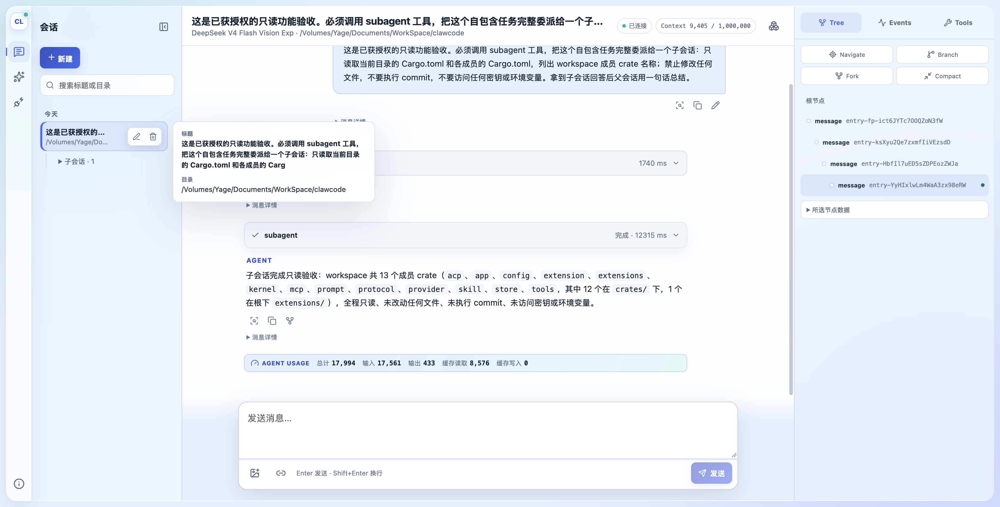
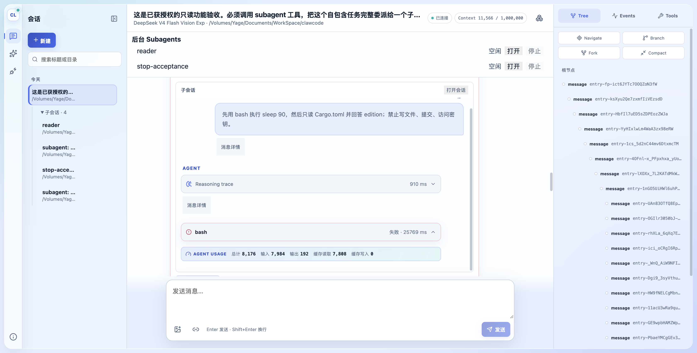
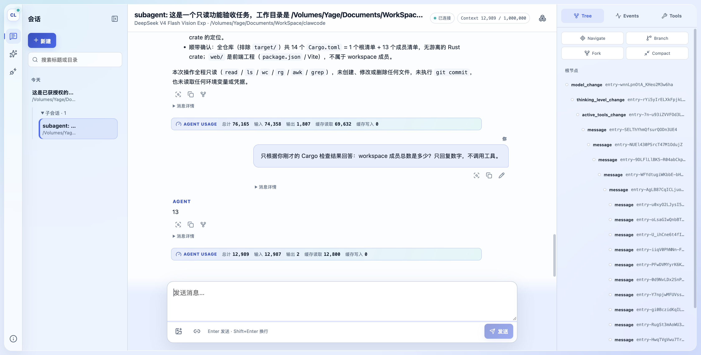
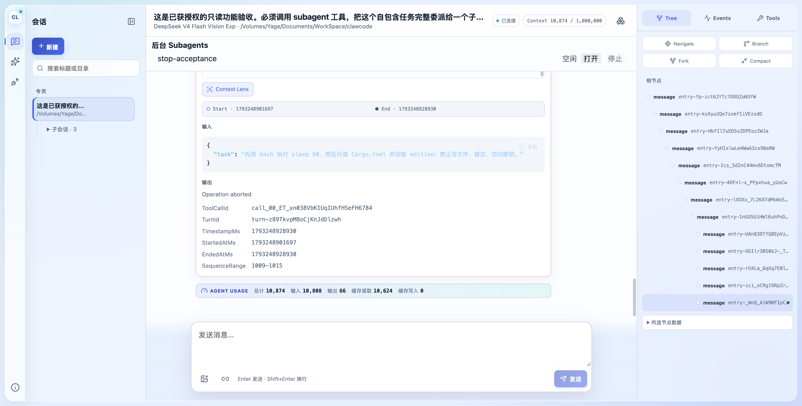
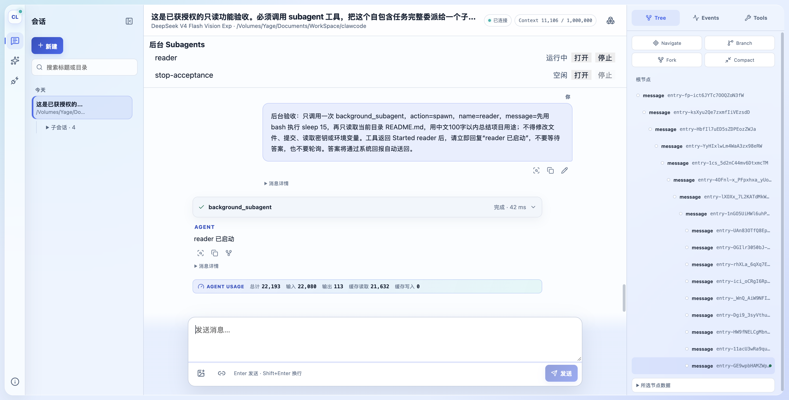
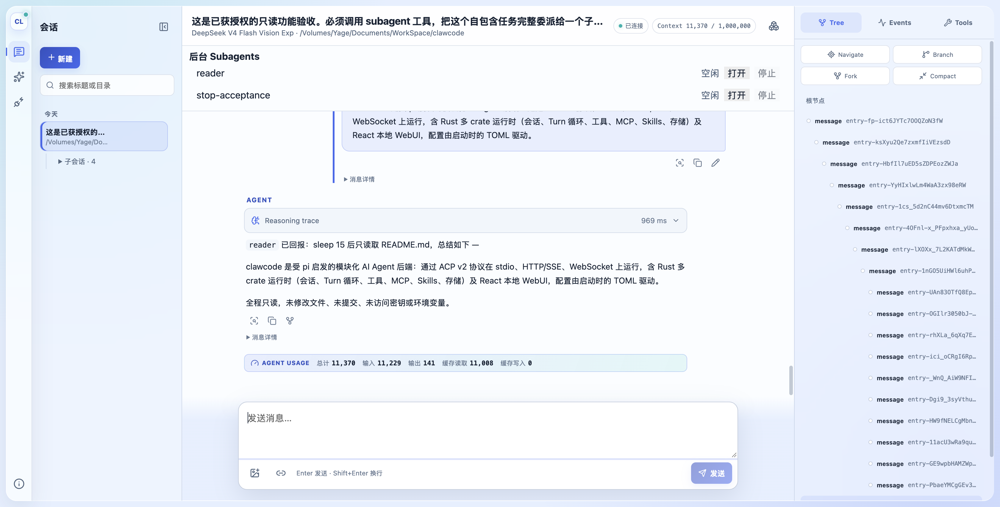
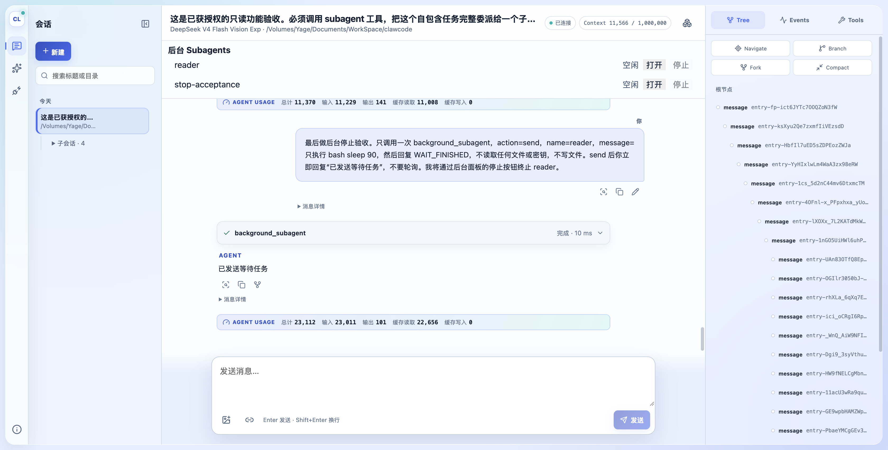
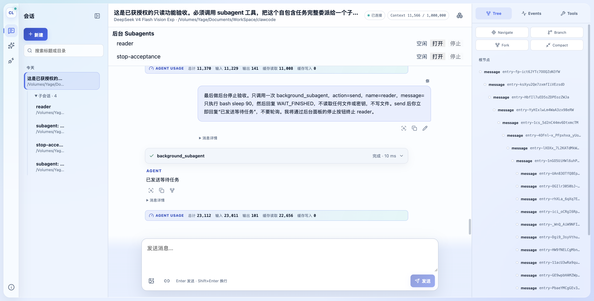
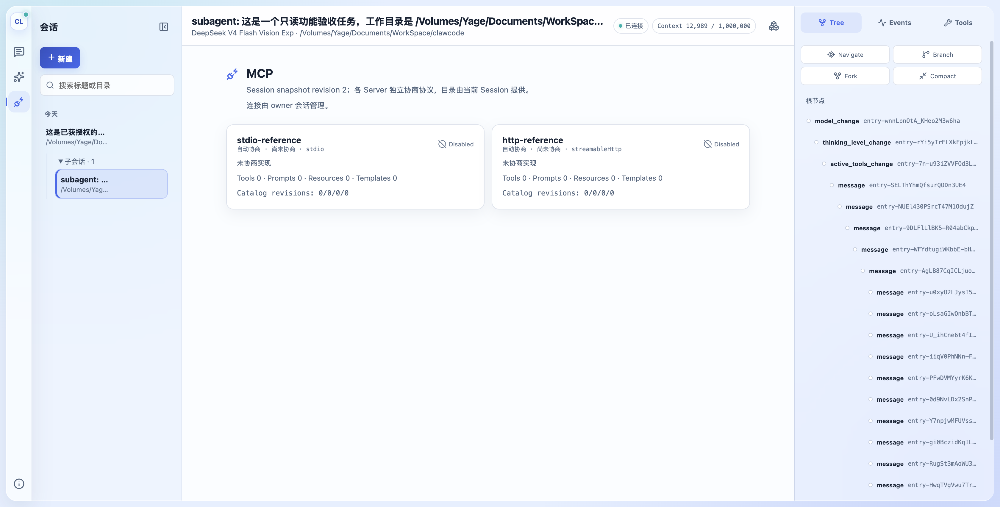

# Subagent 实现与验证记录

## 当前结论

后续评审的六项修复与最新 795 项通过结果见 [评审修复与 Pi 对照](2026-10-28-subagent-review-fixes.md)。下文保留首轮实现与验收记录。

设计与计划的第 1–14 项已完成。第 14 项使用生产 app、DeepSeek 官方 API 和环境变量 DEEPSEEK_API_KEY 完成真实 WebUI 验收；没有替换为 fixture backend。代码保留在当前工作区，没有创建 worktree、commit 或新增依赖。

## 已实现范围

| 计划任务 | 结果 |
| --- | --- |
| 1–2 | SessionOwnership 的协议、JSONL header、列表元数据；独立 OwnedSessionCreateOptions/create_owned；SettingChange 统一模型与 thinking 设置的读写。普通会话和旧 header 保持兼容。 |
| 3–4 | Kernel::submit、事件 sink、父取消令牌派生、排队/滞留消息处理与结算；子会话复制 model/thinking/工具策略，并禁用递归委派工具。 |
| 5–6 | MCP Owned/Shared lease、按 session_id 路由的 elicitation/sampling；关闭、删除和恢复按 ownership 级联；孤儿会话恢复时独立连接 MCP。 |
| 7–8 | 前台 subagent、部分结果及最终 details；扩展同名工具优先；Kernel 发起的 run 进入 ACP 投影和恢复日志；session/list 返回 ownership。 |
| 9–10 | background_subagent 的 spawn/send/stop/status；Reporter 回投、去重、截断；关闭时先停止准入与工作、再关闭子会话和等待 Reporter。 |
| 11–13 | attachSession 独立订阅；工具卡片中的紧凑子会话；侧栏嵌套；后台状态与停止入口；回报消息样式；子会话 MCP 管理入口只读。 |

## 自动化验证

Rust 实现完成后的工作区检查，以及本轮 WebUI 修复后重新执行的前端检查：

| 命令 | 结果 |
| --- | --- |
| `rtk cargo test --workspace` | **785 passed，9 ignored，104 suites** |
| `rtk cargo clippy --workspace --tests --examples -- -Dwarnings` | 通过，无问题 |
| `rtk cargo fmt --all -- --check` | 通过 |
| `rtk git diff --check` | 通过 |
| `web/` 下 `rtk npm run check` | TypeScript 与 ESLint 通过 |
| `web/` 下 `rtk npm run build` | 生产构建通过 |

第一次工作区测试的 app logging 用例被文件沙箱阻止创建本地 Secret Store；使用正常本机权限重新运行后，全套通过。自动化测试使用本地测试依赖，没有通过它们绕过真实 provider 验收的审批。

新增覆盖包括：ownership header、设置恢复、结构化输入不会执行 bash/Slash Command、忙时排队与滞留恢复、预先取消、扩展工具覆盖、并行委派、父取消、直接停止或删除子会话、共享连接与 elicitation、孤儿恢复、后台回报/停止/恢复/去重/截断，以及关闭期间的等待和创建竞态。前端按仓库要求未增加单元测试。

日志保存在 `.superpowers/sdd/2026-10-28-subagent-implementation/`，包括 `workspace-tests.log`、`clippy.log`、`web-check.log`、`web-build.log` 和各针对性失败/通过记录。

## 自审修复

当前会话没有可用的 multi-agent 工具，因此执行的是实现者单独一轮自审，没有独立审阅者。以下问题均先通过针对性测试复现，再修复并纳入最终回归：

1. **运行中会话附着阻塞**：Resume 原先等待整个 run 的执行锁，子会话等待 elicitation 时 UI 无法及时订阅。现在已有 active run 时可直接附着，空闲维护操作继续使用执行锁。
2. **关闭等待互锁**：关闭在持有执行锁时等待 Reporter，Reporter 可能也在等该锁。增加关闭准入信号，唤醒并拒绝等待者；不丢弃正在结算的 run。
3. **撤回排队消息得到无关答案**：通过持久化消息身份确认输入确已被消费，否则返回 Cancelled。回答也从持久化记录读取，避免后置压缩移出模型上下文后丢失文本。
4. **子会话启动与父关闭并发**：子会话尚在 Starting 时父关闭会失败并留下子会话。通过 owner 的创建读写锁，让关闭等待已开始的创建/恢复完成，再扫描级联。
5. **ACP 投影引用环**：Kernel 安装 sink 后通过 ProjectionRegistry 又持有自身。sink 改为 Weak 引用；协议宿主释放后，不再永久保留 registry。

## 实施调整及边界

| 调整 | 原因与影响 |
| --- | --- |
| 保留关闭后 `session_runtime` 返回 idle | 计划示例期待 NotFound，与现有公开语义不符。用需要 live session 的接口验证关闭，保留 UI 状态查询兼容性。 |
| 复用 `tests/mcp_host.rs` 的 MCP 替身 | 避免复制 SamplingClient；共享连接、路由与生命周期仍走真实 Kernel/MCP 代码。 |
| 合并 fmt/clippy/全套回归检查点 | 没有按任务逐次提交；最终工作区统一验证。未获授权的 commit 步骤均未执行。 |
| ACP 投影测试模型上下文设为 128000 | 原 8192 小于默认 compaction 预留预算，首次真实 run 会先报 NoContextToCompact；调整测试容量使它实际验证投影。 |
| 后台面板使用每 2 秒轻量 runtime 查询 | 现有代码没有计划所称的可复用定时轮询；查询完成后再安排下一次，不重叠、不为状态查询恢复已关闭子会话。 |
| MCP elicitation 在主界面统一展示 | 同时展示当前会话和已附着前台子会话的请求，每次一个对话框，避免多个内嵌模态框竞争焦点。后台子会话仍需打开后处理。 |
| 弱引用投影、关闭准入和创建同步 | 是为上述已复现竞态及资源释放问题增加的最小同步措施；保持前台取消级联、后台取消边界和既有持久化格式。 |

后台 Reporter 和去重集合按设计只保存在内存；进程崩溃后，不自动补投尚未送达的答案。ownership 查询仍扫描会话集合，未新增索引。

## 生产 WebUI 真实验收

用户已明确授权只读 Cargo/README 内容及工具输出发送给 provider，并进一步指定使用 DeepSeek 官方 API 和 `DEEPSEEK_API_KEY`。确认现有 `claw.toml` 的 `base_url` 已为 `https://api.deepseek.com`，`api_key = { env = "DEEPSEEK_API_KEY" }`；因此未修改原配置，未打印或持久化密钥。

测试使用生产 `app`，监听 `127.0.0.1:3178`，只覆盖测试存储路径 `CLAW_SESSION_PERSISTENCE__DATA_HOME=/private/tmp/clawcode-subagent-verification`。配置模型名为 `deepseek-v4-flash-vision-exp`；[DeepSeek 官方文档](https://api-docs.deepseek.com/)确认仍接受该别名，并由当前 Flash 模型服务。

| 验收场景 | 实际结果 |
| --- | --- |
| 前台隔离委派 | 父会话实际调用 `subagent`，子会话读取 Cargo 清单，返回 13 个 crate，父会话收到工具结果后完成总结。 |
| 实时与折叠 | 运行中的工具卡片自动展开并出现子会话消息和 bash 工具状态；完成后 DOM 为 `data-status="completed"` 且没有 `open` 属性。 |
| 子会话跳转与继续追问 | 从完成的工具卡片点击“打开会话”进入子会话，追问成员总数，真实模型独立回复 `13`。刷新页面、重新回放后仍可展开并打开子会话。 |
| 前台取消级联 | 明确指定同步 `subagent`，子会话运行 `sleep 90` 时点击父会话停止；父子 run 都持久化为 `cancelled`，父工具正文为 `Operation aborted`。 |
| 后台立即返回与回报 | `background_subagent spawn reader` 的工具耗时约 42 ms；父会话回复“reader 已启动”时 reader 仍在运行。reader 等待 15 秒后读取 README，回投一条答案，界面显示 `Subagent · reader` 样式并自动驱动父会话回复；后台面板从运行中变为空闲。 |
| 后台 send 与停止 | 对既有 reader 投递 `sleep 90`，父会话立即返回。点击 reader 后台面板的停止按钮，状态变为空闲，最新 run 持久化为 `cancelled`；reader 的回报总数仍为 1，没有 `WAIT_FINISHED` 回报。 |
| 所有权与侧栏 | 实际 header 记录 Tool/Background ownership；侧栏把四个测试子会话嵌套在同一 owner 下，显示各自标题。 |
| 共享 MCP 管理限制 | 子会话 MCP 页显示“连接由 owner 会话管理”，没有 Reconnect 或 OAuth 管理入口。实际 MCP elicitation/sampling 路由仍以此前后端集成测试为证，本轮未触发外部 MCP 服务交互。 |

第一轮取消提示被真实模型选成了 `background_subagent`，因此该轮只证明后台工作完成，不能算前台取消成功。随后明确指定精确工具名 `subagent`，再执行并验证父子 cancelled；报告使用后一轮结果。模型自身的文字解释不作为取消是否成功的证据。

### 验收中发现并修复的问题

完成事件和历史回放中的 `rawOutput` 是 `AgentMessage`，`details` 位于 `content.details`；运行中的部分结果则直接携带顶层 `details`。工具卡片原先只读取顶层，因此完成后失去“打开会话”入口。

已复用 `SessionUpdateDecoder` 既有的两种 details 格式解析，统一存为 `ToolCallEntity.subagentSessionId`，卡片直接使用该字段，并保留取消前已发现的 child id。前端按仓库规则未增加单元测试；`npm run check`、`npm run build` 通过，真实完成结果、页面刷新回放和子会话跳转复验通过。

### 证据索引

- 父会话：`session-B65e5ZKwzjVp0pvTbgcKy`。
- Cargo 前台子会话：`session-SzBCa2tYc3YjJFNFYZTJV`。
- 取消测试前台子会话：`session-L0MGXi4r2sR6vW9c0CZ_d`。
- reader 后台子会话：`session-zQWNzEiBmm58dvUB0ialL`。
- reader 成功 run：`run-4GCoE__x9cNiO5Ua_9Jgx`；停止 run：`run-dEK8mauynwU9nAaBYxtGn`。
- 浏览器捕获：`.superpowers/sdd/2026-10-28-subagent-implementation/browser-real-provider.json`，capture `d789f4db65492`。记录的浏览器错误数为 0，没有丢弃请求或控制台记录；WebSocket 业务结算另以真实 UI 和 JSONL 记录交叉验证。
- 模型工具实际仅执行只读清单/README 查询、目录列举以及 sleep，没有文件写入或 Git 写操作。

临时测试会话文件保留供复查；本次浏览器检查会话和生产后端进程在验收后关闭。后台 Reporter 崩溃补报不在本期范围，仍保持内存语义；未做独立审阅者复核。
